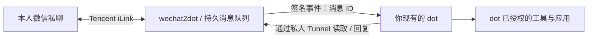

# wechat2dot

**在微信里给你现有的 OpenAI dot 发任务，接收进度和结果。**

[](https://github.com/AndreLYL/wechat2dot/actions/workflows/ci.yml)
[](LICENSE)

**Windows · Linux · macOS 原生运行**

中文 · [English](docs/README_EN.md) · [连接 DOT](docs/CONNECT_DOT.md) · [能力边界](docs/CAPABILITIES.md) · [架构](docs/ARCHITECTURE.md)

> **Alpha。** 支持三平台原生消息引擎、11 个 MCP 工具、事件订阅、附件与进度回传。真实微信 ↔ DOT 验收尚未完成；账号需要具备私人插件、MCP Events 和 Secure MCP Tunnel 权限。



微信入口复用现有 dot 的工具和权限。桥接不调用另一个模型，不要求模型 API key；Tunnel 使用自己的运行凭据，dot 的正常用量仍适用。项目与 OpenAI、腾讯没有官方合作关系。

## 先体验，无需账号

Python 3.11+，先安装 [uv](https://docs.astral.sh/uv/getting-started/installation/)：

```sh
git clone https://github.com/AndreLYL/wechat2dot.git
cd wechat2dot
uv sync --frozen --extra setup
uv run wechat2dot doctor
uv run wechat2dot demo
```

三个系统的 `demo` 都运行实际消息存储、MCP 工具和事件签名引擎，模拟微信及 DOT 的网络边界，检查进度、最终回复、去重与重启恢复。不扫码、不连接真实账号。`demo --preview` 可以只查看协议结构。

Docker 也是可选部署方式：

```sh
docker build -t wechat2dot:local .
docker run --rm --network none wechat2dot:local demo
```

## 接上自己的 DOT

Windows、Linux、macOS 使用相同 CLI 原生运行，不要求安装 Docker 或 WSL。按 [接入指南](docs/CONNECT_DOT.md)依次核对权限、创建私人配置、扫码绑定、连接 Tunnel、订阅事件、恢复收信，再完成微信端真人验收。需要容器部署时见 [Docker 指南](docs/DOCKER.md)。

持续使用需配置受管进程、系统恢复检查与订阅续期，见[稳定性与恢复](docs/RELIABILITY.md)。本机休眠或关机期间无法处理微信任务。

## 第一版能做什么

| 能力 | 实现与限制 |
| --- | --- |
| 文字任务 | 本人私聊收信 → 事件 → 原 dot 读取 → 回复；SQLite 持久队列 |
| 进度、长回复 | `final:false` 中间回复；最终结果；长文本分段与发送状态 |
| 图片、文件、视频 | 接收、读取、暂存、回传；每个附件最多 20 MiB |
| 语音 | 保留音频及微信提供的转写；没有转写时不自动声称识别成功 |
| 断线恢复 | 待处理任务、消息去重、失败状态；不确定发送需人工核对 |
| 工具能力 | 由原 dot 的授权决定；首次实测后才能确认具体应用可用 |

群聊、任意主动推送、微信内原生权限审批、电脑接管、完整历史迁移和语音通话暂未实现。生成文件可通过文本 / 分块字节 / 服务可访问的 HTTPS 地址回传；内部 `sandbox:` 路径不能直接导出。详见 [能力矩阵](docs/CAPABILITIES.md)。

## 设计与贡献

采用统一任务与消息核心、微信通道、DOT 连接和原生平台适配层。消息与附件落入持久队列，执行权限留在现有 DOT，平台差异集中处理。设计取舍见 [架构说明](docs/ARCHITECTURE.md)。

欢迎提交脱敏安装反馈和可复现修复，详见 [CONTRIBUTING.md](CONTRIBUTING.md)。
