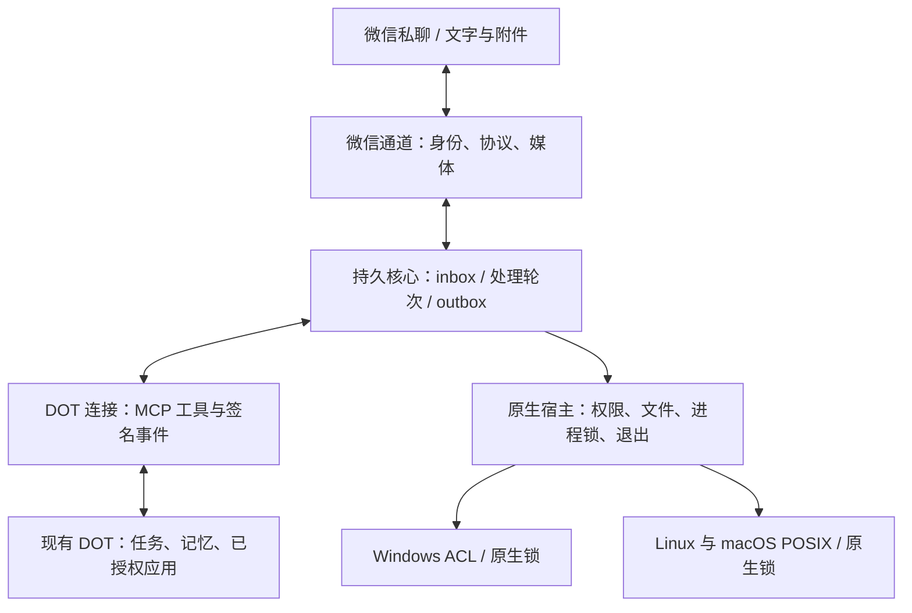

# wechat2dot 的实现思路

把微信作为现有 DOT 的任务入口，用一套跨平台核心连接消息、任务与结果。平台差异留在宿主层，DOT 的工具、记忆和权限留在原有 DOT 上。

## 四个边界

1. **微信通道**负责扫码身份、iLink 收发和媒体格式。收到的正文是任务数据，不能改变运行权限或认证配置。
2. **持久核心**把消息、游标、处理轮次和回复分别保存。相同消息只入库一次；进度与完成分开；接受过的片段不重发。旧任务版本不能覆盖新任务。
3. **DOT 连接**只发送消息 ID 的事件，让同一个 DOT 用 MCP 工具读取正文并处理任务。执行完成与回复受理分别记录，附件通过有界字节或可访问 HTTPS 导出。
4. **原生宿主**在 `wechat2dot/platform.py` 集中处理系统差异。Windows 使用原生安全描述符创建文件与目录，校验句柄 ACL；Linux/macOS 校验 UID 与模式。进程锁阻止同一绑定的第二个接收者。三个系统使用相同业务代码和协议。

## 验证方法

三平台都测试实际服务子进程的 MCP 发现、工具列表、无效帧恢复、单进程锁和 EOF 退出。共享离线演示跑真实 inbox、事件签名、工具读写、进度 / 最终回复、去重和重启恢复。附件与备份测试按原始字节比对，不只看状态字段。

Windows 测试核验 ACL 并拒绝目录 junction；POSIX 测试核验权限并拒绝 symlink。CI 分别运行 Windows、Linux、macOS，而 Docker 只作为额外部署选项。

这些证明软件在各平台可以运行。真实微信回信、DOT 实际工具调用和平台原生审批仍要在自己的账号验收；尚未公开的控制接口不能用本地任务状态替代。
