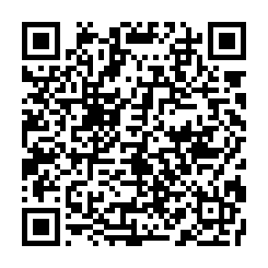

# AI Native 交流群 / AI Native Community

[中文 README](../README.md) · [English README](README_EN.md) · [GitHub Issues](https://github.com/AndreLYL/wechat2dot/issues)

欢迎对 wechat2dot、Personal Agent、MCP 和 AI 自动化感兴趣的朋友加入。这里是一个自愿参与的技术交流与开源共创社区。

- 交流项目部署、使用经验和排错方法。
- 讨论 Personal Agent 架构、工具集成及 AI 自动化实践。
- 分享功能建议、开发经验和开源贡献。

## 微信扫码加入 / Join via WeChat

**当前二维码有效期：2026 年 12 月 5 日前。** 微信群二维码有有效期；如已过期，请稍后返回本页查看更新。

加入群聊完全自愿。请勿公开账号凭据、Token、二维码登录凭证或未经脱敏的日志。可复现的 Bug 和功能需求建议提交到 GitHub Issues，便于公开跟踪。

The AI Native community welcomes anyone interested in wechat2dot, Personal Agents, MCP integrations, and AI automation. Participation is optional. Scan the invitation QR code using WeChat to join.

**Current invitation expires before December 5, 2026.** If the code has expired, check this page again for an updated invitation. Please use GitHub Issues for reproducible bugs and feature requests, and never share credentials, login QR codes, tokens or unredacted logs.
