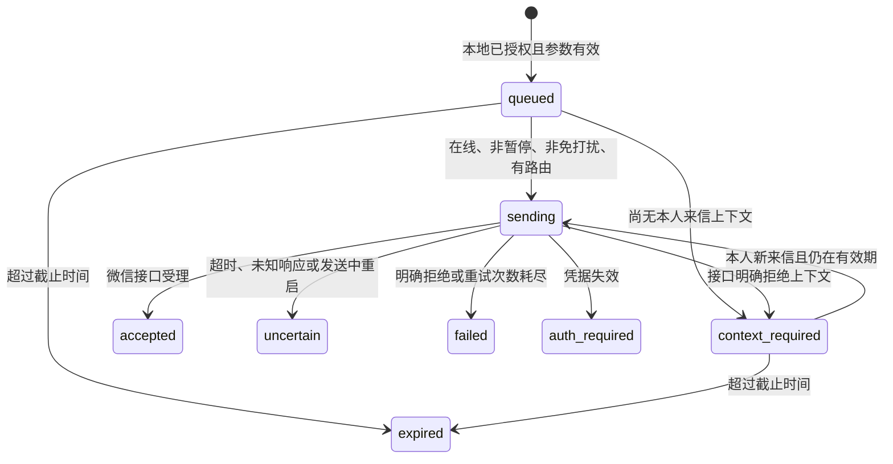

# DOT 主动通知到本人微信（实验性）

本功能适用于包含 `send_weixin_notification` 的源码版本，**v0.2.0-alpha.2 发布包不含此功能**。它让 DOT 的定时任务使用独立通知队列，不必借用旧消息的 `message_id` 或重新打开已经完成的聊天任务。

DOT 负责到点执行、生成内容和调用工具；桥接负责本人路由、持久化、去重、过期和发送。桥接不创建 DOT 定时任务，也不能保证平台准点唤醒。第一版只支持文字。

## 先接通，再启用

1. 完成 [README](../README.md) 的微信绑定、Tunnel、私人插件和文字收发验收。本人至少发过一条微信，才能缓存发送所需的 `context_token`。
2. 按[维护与升级](RELIABILITY.md)先停止恢复检查和桥接，保留升级前备份，再切换到包含本功能的源码。用 `uv sync --frozen --extra setup` 安装锁定依赖。
3. 在项目目录执行以下命令（Windows PowerShell、Linux、macOS 相同）：

```sh
uv run wechat2dot --config ./runtime/bridge.json notifications --enable --quiet-start 22:00 --quiet-end 08:00 --utc-offset-minutes 480
```

预期：`enabled: true`，`paused: false`，静默时段为 UTC+8 的 22:00～次日 08:00。`context_available: true` 仅证明缓存存在，不证明腾讯仍接受它。全新配置默认关闭；私人插件不能自行授予通知权限。

若不需要免打扰，使用 `notifications --enable`；重新配置时省略两个时段参数会清除旧时段。起止必须成对，格式 `HH:MM`，不能相同。时区是固定 UTC 分钟偏移，不自动调整夏令时。重新启用会保留原来的 `paused` 值；若为 true，通过下述暂停工具恢复。

4. 按原方式恢复后台运行和恢复检查；前台用户重新执行原来的 Tunnel 启动命令。不要同时启动两个消费者。
5. 在私人插件侧重新发现工具，确认共 **14 个工具**，包括下面三个。若 DOT 仍缓存旧工具列表，按插件页面提供的刷新/重连流程操作。

停止服务后可用 `notifications` 查看设置，或用 `notifications --disable` 撤回本地授权。运行期间用 MCP 状态查询或普通 `status` 查看通知状态；不要为检查状态重复启动服务。CLI 报 `already_running` 时，先停止后台恢复检查与受管运行。

## 三个接口

| MCP 工具 | 参数 | 行为 |
| --- | --- | --- |
| `send_weixin_notification` | `text`, `notification_key`, `expires_at` | 为绑定本人入队一条通知，返回通知 ID 与状态 |
| `get_weixin_notification_status` | 可选 `notification_id` | 查询单条；省略时返回本地策略和最近 20 条状态 |
| `set_weixin_notifications_paused` | `paused: true / false` | 暂停/恢复已获本地授权的通知；不能启用默认关闭的权限 |

- `text`：非空，最多 2,000 个字符、8,000 UTF-8 字节，无附件。
- `notification_key`：1～128 个 ASCII 字母、数字、下划线或连字符。每个**逻辑执行周期**固定一个键，例如 `daily_brief_20261106_0900`；同一次执行重试不能换键。
- `expires_at`：绝对 Unix 时间戳（秒），新通知必须晚于当前时间且不超过 7 天。建议日常简报只给 1～2 小时有效期。重试必须保留首次正文与绝对截止时间；同键不同内容/截止时间返回 `notification_key_conflict`。
- 无收件人、`message_id`、`processing_id` 参数。所有通知只能发送给当前绑定本人。

暂停期间拒绝新入队，已入队通知等待恢复或过期；免打扰期间允许入队但不领取发送。两者都不影响普通微信聊天回复，也不会取消 DOT 的定时任务。已经领取的在途发送可能完成。

可以给 DOT 这样的任务说明，再在 DOT 内确认实际定时任务已创建：

> 每天 09:00（明确指定我的时区）生成我已授权信息范围内的简报。通过 send_weixin_notification 发给我。每个计划执行日期使用一个固定 notification_key，截止时间取该次计划时刻之后两小时的 Unix 秒数。同一次执行重试保留首次正文、键和截止时间；先检查已有通知状态，禁止靠更换键重复推送。不要调用 reply_weixin_message 或借用历史 processing_id。若通知关闭或暂停，停止发送；uncertain 时请在 DOT 内提示我人工核对，不要自动补发。

工具不会自行读取日历、邮件或生成建议；这些仍依赖 DOT 的现有授权。请从单条无敏感内容的测试开始。

## 状态与恢复



`queued` 不是已发出，`accepted` 也不是手机已收到，`delivered` 始终为 null；请用手机核对。等待上下文的通知不会阻塞其他队列；上下文拒绝最多发送 3 次，每次须有新来信。`ret=-2` 沿用现有发送器的限流分类，不视为上下文失效。

| 情况 | 处理 |
| --- | --- |
| `context_required` | 本人在微信发一条新消息，再查询状态；已过期的通知不会补发 |
| `expired` | 不重放过时内容；下一执行周期创建新的通知 |
| `failed` / `auth_required` | 在 DOT 或 `diagnose` 查看固定错误码，先修复通道/凭据；不会自动重发 |
| `uncertain` | 先在手机核对，保留记录；第一版没有通知的人工重试/结案接口，不能用旧的 `retry-send` / `resolve-send` 处理通知 ID |
| `notification_queue_full` | 本人最多 32 条等待或在途通知，等待处理/过期后再提交 |
| `notification_history_full` | 达到 4,096 条去重记录上限，停止创建通知并联系维护者；第一版不提供自动清除去重记录的操作，不要删库绕过 |

队列与普通回复共用串行发送器和限流退避，并交替领取以避免一侧持续饥饿。`status` 包含通知摘要，`diagnose` 包含失败/不确定等问题，不输出通知正文或路由凭据。

## 隐私、升级与能力边界

通知正文、最近本人上下文和去重记录存储在现有私有 SQLite 中，沿用操作系统权限保护，备份也包含它们。独立路由不会随聊天历史清理而消失；只接受本人新来信更新，旧记录和空轮询不能将其回退。

发送器/入队时会清理已过期的终态正文（保留状态、摘要和去重键派生 ID）；`sending` 和 `uncertain` 保留待核对数据。停止运行不承诺按时清理。成功发送的引用文本还受现有引用缓存保留策略约束；这不是即时擦除功能。

数据库增加迁移版本 9，迁移默认不授权主动通知；原有聊天任务和回复保留。旧程序不能读取升级后的库，回退必须使用升级前备份。恢复备份默认禁用收发；确认唯一消费者并检查队列后才恢复。历史备份不包含备份之后的发送结果，不能据此断言未发送。

“无新消息”仍使用最后一次本人来信留下的腾讯上下文，不是无限期离线推送承诺。电脑、网络、桥接和 Tunnel 必须在线；跨天、长期无新来信、真实 DOT 定时执行和手机可见性需要另行验收。此变更的自动化测试仅使用模拟传输。

## 维护者复现

```sh
uv sync --frozen --all-extras
uv run --frozen python -m unittest discover -s tests -p test_notifications.py -v
uv run --frozen python -m unittest discover -s prototype_tests -v
```

Linux/macOS 再运行完整 `tests` 套件及 `scripts/verify-upgrade.py`；完整 CI 还检查打包、全新 wheel 安装和容器。通知套件在 Windows、Linux、macOS 均运行，覆盖并发去重、事务迁移回滚、恢复备份、旧任务隔离、免打扰、过期、失败分类和不确定发送不重放。

真人验收：授权并启用后，在 DOT 建立几分钟后的单次任务，发送唯一标记与简单计算结果；期间不发新微信。检查工具状态，再由手机确认收到一次。随后测试暂停、过期与较长无新来信间隔；不要用生产账户模拟断网中断发送，也不要把账号数据放入 Issue。
